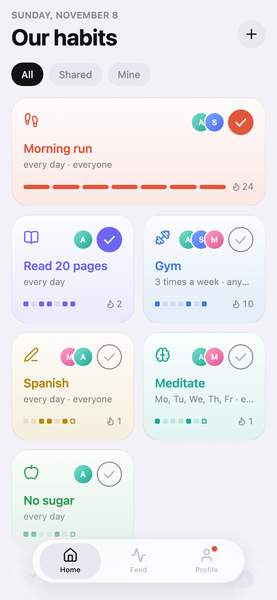
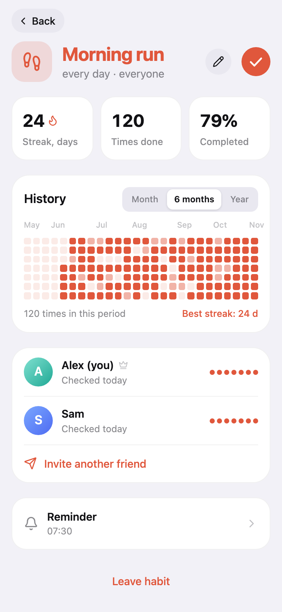
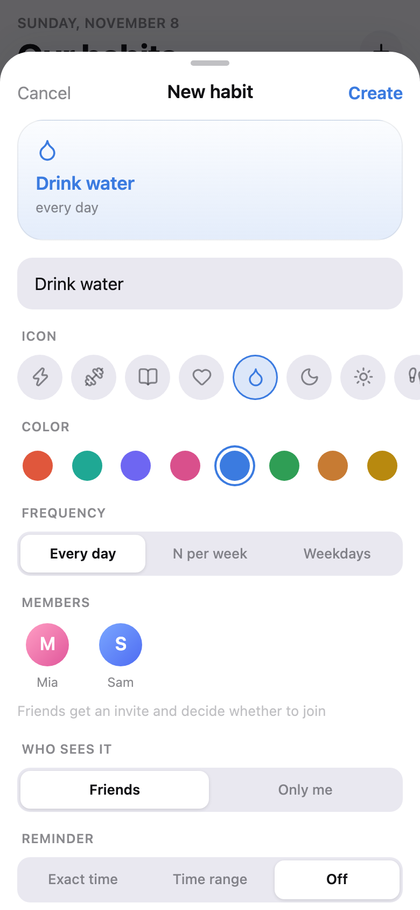
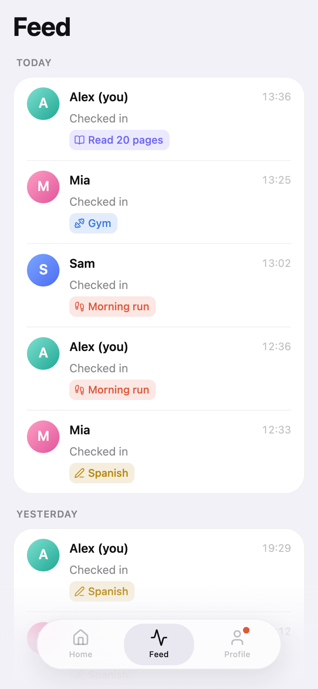
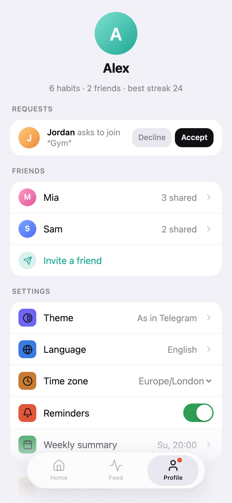
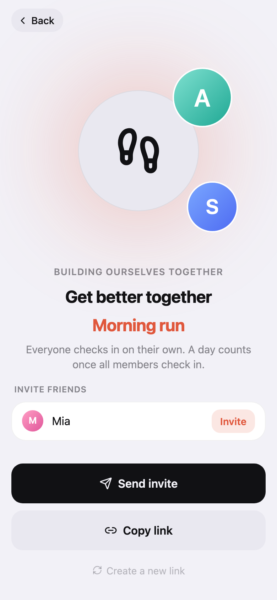

# couple-habit

A habit tracker that lives inside Telegram. Track habits on your own or together with friends, keep your streaks going and see when others check in.

It's a Telegram bot plus a Mini App (a small web app that opens right in the chat), running on Yandex Cloud.

## Screenshots

Made-up demo data. GitHub shows the dark or light version depending on your theme.

<table>
  <tr>
    <td><picture><source media="(prefers-color-scheme: dark)" srcset="docs/screenshots/home-dark.png"></picture></td>
    <td><picture><source media="(prefers-color-scheme: dark)" srcset="docs/screenshots/habit-dark.png"></picture></td>
    <td><picture><source media="(prefers-color-scheme: dark)" srcset="docs/screenshots/new-habit-dark.png"></picture></td>
  </tr>
  <tr>
    <td><picture><source media="(prefers-color-scheme: dark)" srcset="docs/screenshots/feed-dark.png"></picture></td>
    <td><picture><source media="(prefers-color-scheme: dark)" srcset="docs/screenshots/profile-dark.png"></picture></td>
    <td><picture><source media="(prefers-color-scheme: dark)" srcset="docs/screenshots/invite-dark.png"></picture></td>
  </tr>
</table>

## What it does

- Habits can be daily, on certain days of the week, or a set number of times per week.
- A habit can be just yours or shared with friends. For a shared one, the owner picks when a day counts: when everyone checks in, or when anyone does. People who join later only count from the day they joined.
- Streaks work for every kind of schedule. Today doesn't break your streak until the day is actually over.
- Everyone has their own time zone, so "today" always means your today.
- To add a friend, send them a link. They tap Join, you approve. You can also invite a friend straight into a habit.
- Everything happens in the app. The bot only has `/start` and sends notifications: a friend checked in, a new request, a reminder, a weekly summary. They come with quick buttons like "Check mine too" and "Accept".
- Reminders go off at a set time or at a random minute inside a time range.
- Russian and English. The language follows Telegram, and you can change it in settings.

## How it's built

```
packages/core   the app logic: dates, schedules, streaks, habits, friends, feed
apps/web        the Mini App
apps/server     REST API, Telegram bot, storage, cloud functions
apps/relay      Cloudflare Worker that passes messages between Telegram and the server
scripts         deploy, demo data, screenshots
```

The core knows nothing about Telegram or HTTP, so the same code runs on a laptop and in the cloud.

## Deploy

Everything runs on Yandex Cloud and fits in the free tier for a few people.

```
Telegram ──▶ relay ──▶ API Gateway ──▶ habit-api ──▶ data bucket
Mini App ─────────────▶ API Gateway ──▶ web bucket + habit-api
timer, every minute ──────────────────▶ habit-tick ──▶ data bucket
habit-api, habit-tick ──▶ relay ──▶ Telegram
```

### Why there's a relay

Right now Telegram's servers and Russian data centers can't reach each other, it's blocked both ways. People in Russia still reach Yandex Cloud fine. So the Mini App, the API and the data stay in Yandex Cloud, and only the bot's messages go through a small Cloudflare Worker. It forwards Telegram's updates to the server and the server's calls back to Telegram. Nothing else gets through, so nobody can use it as a free proxy.

### Running it

You'll need:

- the [yc CLI](https://yandex.cloud/docs/cli/quickstart) set up with `yc init`, and a cloud with billing turned on
- a free Cloudflare account, logged in with `npx wrangler login`
- `BOT_TOKEN` in `.env`

```bash
npm run deploy
```

It's safe to run again and again: it creates what's missing and updates the rest (service account, buckets, functions, API Gateway, relay, timer, webhook, menu button).

After the first deploy, open @BotFather and set the printed URL as the bot's Main Mini App. Without it, invite links (`t.me/<bot>?startapp=...`) won't open the app.

### Where the data lives

All the data is one JSON file in a private bucket. Each request loads it, makes its changes and saves it back, but only if nobody saved in between. If someone did, the request runs again on the fresh data, so two people checking in at the same moment never overwrite each other. Old versions are kept for 30 days, just in case.

There's also a YDB version (`DEPLOY_STORAGE=ydb npm run deploy`). Right now serverless YDB times out on any query that reads a table, even in a brand new database, so the JSON file is the default.

### Security

- The cloud account can only read the app's files, write to the data folder and call its own two functions.
- Requests without Telegram's signature or the webhook secret are turned away before any data is loaded.
- Secrets are made once and saved to `.data/deploy.json`, which isn't in git. If the deploy fails, the error hides them.

While the webhook is set, `npm run dev` only runs the local API. It won't grab the bot, change its menu or send reminders. To work on the bot locally, run `BOT_POLLING=force npm run dev`. This removes the webhook, and `npm run deploy` puts it back.

## Run locally

You need Node.js 22 or newer.

```bash
npm install
cp .env.example .env   # paste your bot token from @BotFather into BOT_TOKEN
npm run dev            # API on port 8787, plus the bot and reminders
```

Data is saved to `.data/db.json`.

In a second terminal, start the Mini App:

```bash
npm run dev:web        # http://localhost:5173
```

Outside Telegram there's no login, so the dev server signs requests as the user from `DEV_USER_ID` in `.env`. It only does that on `localhost`. Anywhere else you need real Telegram data.

To call the API by hand:

```bash
npm run initdata -w @habit/server -- <your Telegram id> Alex   # prints a header to use
curl -H "Authorization: tma ..." http://localhost:8787/api/v1/habits
```

## Scripts

| Command | What it does |
| --- | --- |
| `npm test` | runs all tests |
| `npm run coverage` | tests plus a coverage report |
| `npm run typecheck` | checks types |
| `npm run dev` | local API and bot, restarts on changes |
| `npm run dev:web` | the Mini App on localhost |
| `npm run build -w @habit/web` | builds the Mini App |
| `npm run deploy` | puts everything on Yandex Cloud |
| `npm run demo-data` | makes demo people and history in `.data/demo.json` |
| `npm run screenshots` | takes the screenshots above (steps in `scripts/screenshots.ts`) |

## API

Everything is under `/api/v1`. Each request needs `Authorization: tma <Telegram.WebApp.initData>`. The server checks Telegram's signature with the bot token, and it's good for 24 hours.

Answers look like `{ "data": ... }`, errors like `{ "error": { "code", "message" } }`.

| Method | Path | What it does |
| --- | --- | --- |
| POST | `/session` | opens the app, saves your time zone, tells the app which screen a link should open |
| GET / PATCH | `/me` | your profile and settings |
| GET / POST | `/habits` | your habits (`?archived=true` for the archive) / new habit |
| GET / PATCH | `/habits/:id` | one habit / edit it (owner) |
| POST | `/habits/:id/archive`, `/unarchive`, `/transfer` | owner actions |
| PATCH / DELETE | `/habits/:id/membership` | your reminder and notifications / leave |
| DELETE | `/habits/:id/members/:userId` | remove someone (owner) |
| GET | `/habits/:id/checks?from&to` | days for the heatmap |
| PUT / DELETE | `/habits/:id/checks/:date` | check or uncheck a day |
| GET / POST | `/invite-link`, `/invite-link/reset` | your friend link |
| GET / POST | `/habits/:id/invite-link`, `/reset` | a habit link (owner) |
| GET | `/invites/:token` | what an invite is: who sent it, which habit |
| POST | `/invites/:token/requests` | ask to join |
| POST | `/habits/:id/invites` | invite a friend straight into a habit |
| GET | `/requests` | requests waiting for you |
| POST | `/requests/:id/approve`, `/decline` | answer a request |
| GET / DELETE | `/friends`, `/friends/:userId` | your friends / remove one |
| GET | `/feed?before&limit` | what friends have been up to, page by page |

## Deep links

The same short codes open a screen from an invite link (`startapp`) or from the bot's Open button:

| Code | Opens |
| --- | --- |
| `i_<token>` | an invite |
| `h_<habitId>` | a habit |
| `requests`, `feed`, `home` | that tab |

## Tech

TypeScript, Node.js 22, React 19, Vite, Tailwind, Motion, TanStack Query, [grammY](https://grammy.dev), [Hono](https://hono.dev), Zod, Vitest, Playwright. Hosting: Yandex Cloud Functions, API Gateway, Object Storage, plus a Cloudflare Worker.
